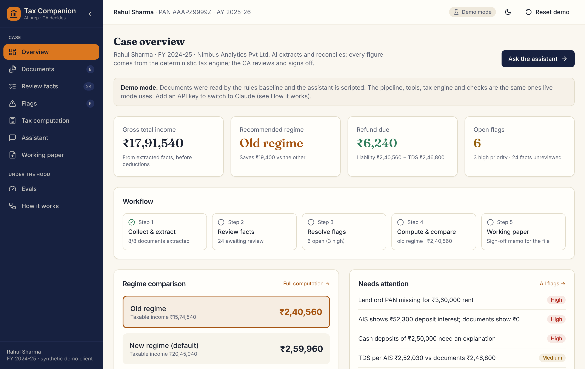
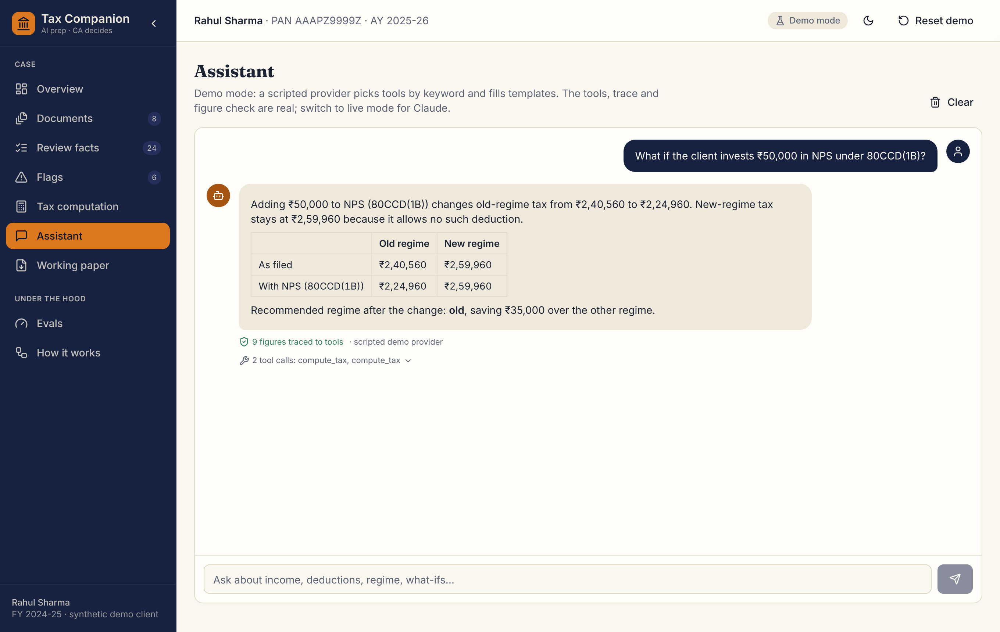
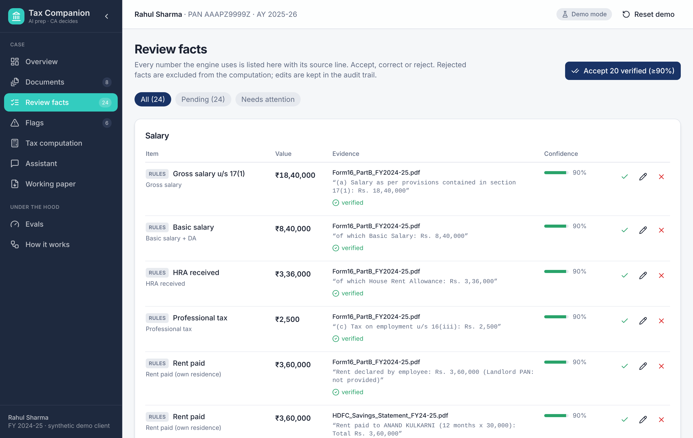
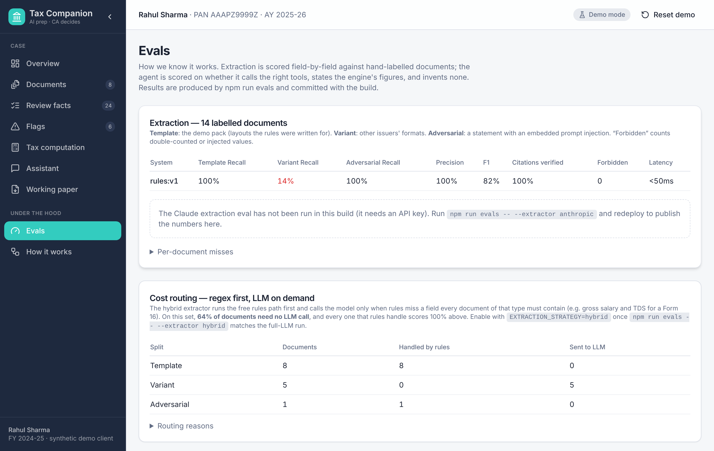

# Tax Companion

**AI-assisted income-tax preparation for Chartered Accountant firms in India.** An LLM reads the client's messy document pack and drafts the facts. Deterministic code checks those facts against the documents and AIS, and computes the tax. The CA reviews every number and signs off.

> Portfolio project showing an applied-AI / forward-deployed engineering approach to a regulated workflow. All client data is synthetic.

| | |
|---|---|
| **Problem** | During July filing season a CA firm spends 45–90 min per salaried client copying numbers out of Form 16, AIS, bank statements and receipts, then reconciling them. Most of that time goes to finding numbers, not to judgement. |
| **What it does** | Extracts facts with verbatim citations, verifies each citation in code, reconciles against AIS, computes old vs new regime with a line-by-line trace, answers questions through a tool-using assistant, and produces a sign-off working paper. |
| **Design stance** | The LLM is used only where judgement over unstructured input pays off. Arithmetic, thresholds, caps and reconciliation are tested code. The model cannot put a number on screen that code has not produced or verified. |
| **Proof** | 61 unit tests, including a hand-verified tax engine. A labelled extraction eval with template, variant and adversarial splits. An agent eval. A live-mode smoke test against a mock Messages API. All run in CI. |

| Overview | Assistant with tool trace |
|---|---|
|  |  |
| **Review facts with verified citations** | **Evals: rules baseline vs LLM** |
|  |  |

## Try it

```bash
npm install
```

```bash
npm run dev
```

Then open http://localhost:8080. Without an API key it runs in **demo mode**: documents are read by a rules baseline and the assistant is a scripted provider. The tools, tax engine, verification checks and UI are the same ones live mode uses.

For **live mode**, put `ANTHROPIC_API_KEY=...` in `.env.local` and restart. The key stays on the server: Vite serves the same handlers as the Vercel functions in `api/`.

A good path through the demo:

1. **Overview**: the old regime wins by ₹19,400, and there are 6 open flags.
2. **Flags**: AIS shows ₹52,300 of FD interest with no certificate, rent is above ₹1L with no landlord PAN, and there is a ₹2.5L cash deposit. Click **Draft client email**.
3. **Review facts**: every number is shown with its source line and a ✓ verified badge. Add the FD interest manually and the AIS flag clears itself.
4. **Assistant**: ask *"What if the client invests ₹50,000 in NPS?"*. Open the tool trace and note the "figures traced to tools" badge.
5. **Tax computation**: both regimes side by side, each line tagged with its section.
6. **Evals**: what the LLM is for. The rules baseline gets 100% recall on template documents but **14% on other issuers' formats**.

## Practice workspace (beta)

At `/app`, a CA firm can sign in, see its client list, and work on cases that are saved on the server and shared across the firm. Partners invite preparers by link, and only partners can mark a case final. Every change lands in an append-only audit trail. Firms are isolated from each other; this is tested against real Postgres in CI. The public demo at `/` is unchanged and needs no account.

```bash
DATABASE_URL=postgres://... BETTER_AUTH_SECRET=$(openssl rand -base64 32) npm run db:migrate
```

Then run `npm run dev` with the same variables and open http://localhost:8080/app. Design decisions are in [`docs/adr/0001-db-and-auth.md`](docs/adr/0001-db-and-auth.md). The plan and its status are in [`.claude/plans/practice-workspace.plan.md`](.claude/plans/practice-workspace.plan.md).

## Architecture

```
 documents ──► LLM extraction ──► verify & reconcile ──► CA review ──► tax engine ──► working paper
   (PDF/img/txt)   structured output   citation check (code)  accept/edit/    FY24-25, old vs new   deterministic memo
                   + quote + conf.     AIS vs docs (code)      reject facts   line-by-line trace     + audit trail
                   + client questions  thresholds, conflicts                         ▲
                                                                                     │ compute_tax (only source of ₹)
                                                     assistant: bounded tool loop ───┘  + figure-grounding check
```

| Layer | Where | Notes |
|---|---|---|
| Tax engine | `src/engine/` | Pure TypeScript. Slabs, s.87A rebate and marginal relief, surcharge marginal relief, HRA's three limbs, house-property loss caps per regime, s.111A/112A with basic-exemption shortfall, 288A/B rounding. 23 hand-computed tests. |
| Domain | `src/domain/` | Field catalogue (the contract between model and engine), facts with provenance, reconciliation rules that re-run on every change. |
| LLM interface | `src/ai/llm/` | `LLMProvider` with a Claude adapter (official SDK, strict tools, structured outputs, adaptive thinking, server-side refusal fallback) and a scripted adapter for demo mode. Adding a provider means implementing one method. |
| Extraction | `src/ai/extraction/` | JSON-schema structured output, zod re-validation, then a **grounding check**: the quote must appear verbatim in the document and contain the value, or confidence is capped at 50% and the fact is flagged. Optional **hybrid routing** (`EXTRACTION_STRATEGY=hybrid`) runs the rules first and calls the LLM only when they miss a field the document type must contain. That skips the model for 64% of the eval set. |
| Assistant | `src/ai/agent/` | Six read-only tools over the case. Bounded loop (6 steps). Tool errors go back to the model as results. Every ₹ amount in the answer is checked against tool output. |
| Server | `server/`, `api/` | Web-standard `Request → Response` handlers, used as Vercel functions and as Vite dev middleware. Body limits, per-IP rate limit, generic client errors (provider detail only in logs), constant-time `ACCESS_TOKEN` check. |
| Evals | `evals/`, `scripts/run-evals.ts` | Field-level precision/recall by split, forbidden-value checks (double counting, injection), citation-verified rate, agent pass rate. Results render on the Evals page. |

## Results (committed in `evals/results/latest.json`)

| System | Template recall | Variant recall | Adversarial | Precision | Citations verified |
|---|---|---|---|---|---|
| `rules:v1` (regex baseline) | 100% | 14% | 100% | 100% | 100% |
| Claude extraction | not yet run (needs a key): `npm run evals -- --extractor anthropic` | | | | |

**Hybrid routing:** 9 of 14 documents (all template docs and the injection attempt) are fully covered by rules and need no LLM call. All 5 variant documents are routed to the LLM.

The baseline is perfect on the layouts it was written for and fails on almost everything else. That gap is why this product needs an LLM. The citation check is why it can safely use one. The Claude rows were not run in this build because no key was available; the command above fills them in, and the Evals page picks them up.

## Docs

- [`docs/DESIGN.md`](docs/DESIGN.md): problem framing, premises, approaches considered, decision
- [`docs/ARCHITECTURE.md`](docs/ARCHITECTURE.md): data flow, failure modes, test plan, trade-offs
- [`docs/EVALS.md`](docs/EVALS.md): eval method, metrics, how to extend
- [`docs/design/THEME.md`](docs/design/THEME.md): the Ledger & Saffron theme (palette, type, contrast table)
- FDE engagement pack, written as if deploying at a 12-person CA firm:
  [discovery](docs/fde/01-discovery.md) · [rollout plan](docs/fde/02-rollout-plan.md) · [runbook](docs/fde/03-runbook.md) · [security & privacy](docs/fde/04-security-privacy.md)

## Scripts

| Command | What it does |
|---|---|
| `npm run dev` | App and `/api` on :8080 |
| `npm test` | Unit tests (engine, extraction, grounding, agent loop) |
| `npm run typecheck` | Strict TS for engine/AI/server, app TS for the UI |
| `npm run db:migrate` | Create/upgrade auth and workspace tables (idempotent) |
| `npm run evals` | Baseline evals. Add `-- --extractor anthropic` or `-- --agent anthropic` for Claude |
| `npm run smoke:live` | Live-mode wiring against a mock Messages API (no key needed) |
| `npm run build` | Production build. Deploy to Vercel as is (`vercel.json`, `api/`) |

## Scope and limits

Covers FY 2024-25, resident individuals below 60, with salary, house property, other sources, listed-equity capital gains, simple business profit and the common Chapter VI-A deductions. It does not cover senior-citizen slabs, agricultural income, foreign assets, F&O, carry-forward of losses across years, or filing the ITR itself. Surcharge marginal relief is computed with a proportional split between normal and special-rate income, which is exact for single-head cases and an approximation for mixed ones. The engine is a demonstration, not tax advice.

Built with React, TypeScript, Vite, Tailwind/shadcn, zod and the Anthropic TypeScript SDK.
